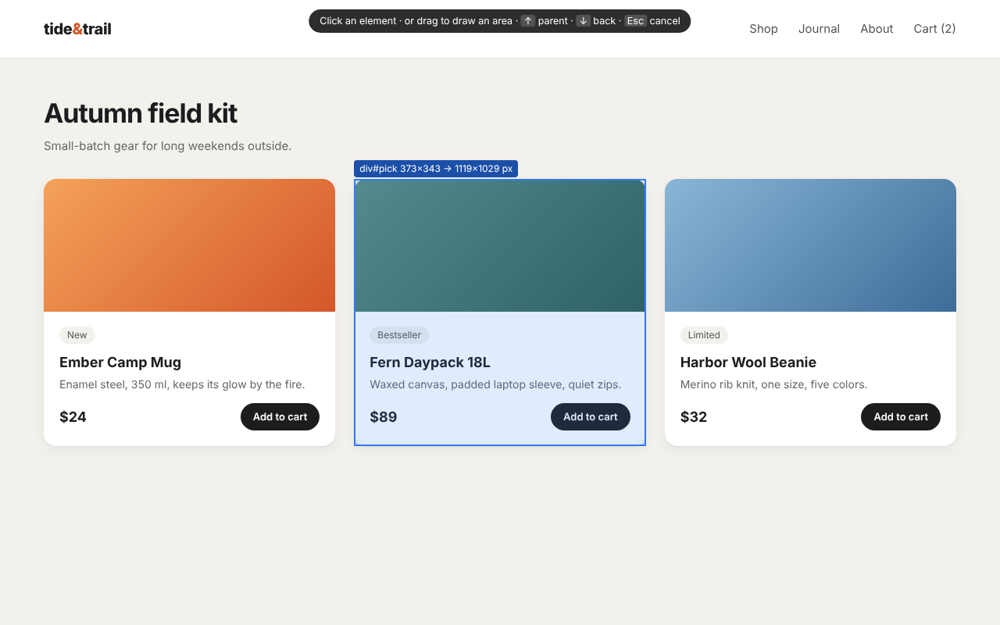
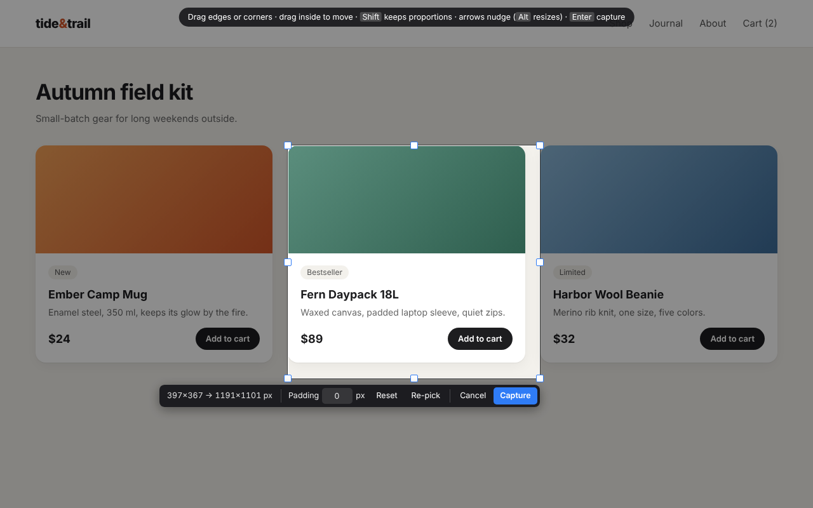

<p align="center"></p>

# Fidelio – Hi-Res Element Screenshot

Screenshot any element on a web page at **3× resolution** (adjustable 1×–8×), with an adjustable crop. Free and open source, for **Firefox** and **Chrome**.

**Website:** [neforus.com/fidelio](https://neforus.com/fidelio/)



## Why

Normal screenshots are limited to your screen's resolution. Fidelio redraws the element you pick at a higher resolution instead of enlarging pixels, so text, icons and edges stay sharp. It captures the whole element, even parts scrolled out of view.

## How to use it

1. Click the toolbar button, press <kbd>Ctrl</kbd>+<kbd>Shift</kbd>+<kbd>.</kbd> (<kbd>⌘</kbd>+<kbd>Shift</kbd>+<kbd>.</kbd> on Mac), or right-click the page.
2. Hover to highlight an element and click it. <kbd>↑</kbd> selects the parent, <kbd>↓</kbd> goes back. Or drag to draw any area.
3. Adjust the crop: drag edges or corners, move the box, add padding, or nudge with the arrow keys (<kbd>Alt</kbd>+arrows resizes, <kbd>Shift</kbd> keeps proportions).
4. Press <kbd>Enter</kbd>. The PNG is saved to `Downloads/Element Screenshots`.



## Install

Fidelio is coming to Firefox Add-ons and the Chrome Web Store. Until then, download a package from [Releases](https://github.com/Neforuss/Fidelio/releases) or [neforus.com/fidelio](https://neforus.com/fidelio/):

- **Chrome / Edge:** unzip, open `chrome://extensions`, turn on Developer mode, click **Load unpacked**, choose the folder.
- **Firefox:** open `about:debugging` → This Firefox → **Load Temporary Add-on** → choose the `.xpi` (removed on restart until the signed version is out).

## How it works

| | Firefox | Chrome |
|---|---|---|
| Manifest | V2 | V3 |
| High-res capture | `tabs.captureTab` with `rect` and `scale` | Briefly attaches the DevTools protocol, sets a higher device scale factor, captures with `Page.captureScreenshot`, then restores and detaches |

The element picker, crop overlay and settings page are shared (`src/`). Each browser has its own manifest and background script (`platform/`).

## Build

```sh
./build.sh
```

Creates `dist/fidelio-<version>-firefox.xpi` and `dist/fidelio-<version>-chrome.zip`. No dependencies and no bundler: the code is plain JavaScript.

## Privacy

Fidelio collects no data and makes no network requests. Screenshots are saved only to your computer.

## License

[MIT](LICENSE) © Neforus

The name Fidelio is a nod to Stanley Kubrick's *Eyes Wide Shut*.
